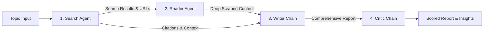

# DeepResearch AI

An autonomous, multi-agent AI research pipeline that conducts comprehensive research on any given topic. Using specialized LangChain agents and chains, it automates the full research lifecycle: querying recent web sources, deep-scraping high-value documents, synthesizing an exhaustive research report, and subjecting the output to rigorous critical evaluation.

---

## Architecture Overview

DeepResearch AI splits the research and writing workflow across four distinct stages:



1. **Search Agent**: Employs Tavily Search to identify top relevant, authoritative web sources and retrieve current snippets.
2. **Reader Agent**: Parses top URLs, strips extraneous HTML/scripts, and extracts high-density full-text content.
3. **Writer Chain**: Synthesizes the raw search results and scraped content into a structured markdown report (Introduction, Key Findings, Conclusion, Sources).
4. **Critic Chain**: Evaluates the written report against strict analytical criteria, providing an objective score (X/10), key strengths, areas for improvement, and a final verdict.

---

## Project Structure

```text
├── app.py              # Modern Streamlit web application with live stage visualization
├── pipeline.py         # Standalone CLI / programmatic execution pipeline
├── agents.py           # Agent and prompt definitions (Search, Reader, Writer, Critic)
├── tools.py            # LangChain tools for Tavily search and web scraping
├── requirements.txt    # Python dependencies
├── .env.example        # Environment variable template
└── .gitignore          # Git exclusion rules
```

---

## Getting Started

### 1. Prerequisites

- Python 3.10 or higher
- An **OpenAI API Key** (for GPT-4o-mini / LLM inference)
- A **Tavily API Key** (for real-time web search capabilities)

### 2. Installation

Clone this repository and create a virtual environment:

```bash
# Create and activate a virtual environment
python3 -m venv venv
source venv/bin/activate  # On Windows: venv\Scripts\activate

# Install dependencies
pip install -r requirements.txt
```

### 3. Environment Configuration

Copy the example environment file and configure your API credentials:

```bash
cp .env.example .env
```

Open `.env` and fill in your keys:

```ini
OPENAI_API_KEY=your_openai_api_key_here
TAVILY_API_KEY=your_tavily_api_key_here
```

---

## Running the Application

### Option A: Interactive Web UI (Streamlit)

Launch the modern web interface with real-time pipeline status tracking:

```bash
streamlit run app.py
```

Open your browser at `http://localhost:8501`. Enter any research topic and click **Run Research Pipeline** to watch the agents collaborate in real-time. You can download the completed research report as a Markdown (`.md`) file directly from the UI.

### Option B: Terminal / CLI Mode

Execute the pipeline in headless mode from your terminal:

```bash
python3 pipeline.py
```

Enter your topic when prompted, and the agents will print their step-by-step progress and final output directly to stdout.

---

## Customization

- **Change Model**: Modify the LLM configuration in [agents.py](file:///Users/mantosh/Desktop/Multi%20Agent/agents.py) (e.g., adjust temperature or switch to other OpenAI models).
- **Prompt Adjustments**: Tailor the writer instructions or critic rubric in [agents.py](file:///Users/mantosh/Desktop/Multi%20Agent/agents.py) to match specific research formats or citation guidelines.
- **Scraper Length / Limits**: Tune max scrape characters and timeout settings in [tools.py](file:///Users/mantosh/Desktop/Multi%20Agent/tools.py).

---

## License

MIT License. Feel free to customize and extend for your own research workflows.
